# Life cycle: 12 stages

Every pet starts as an egg and can live through **twelve stages**:
- **Egg, Baby and Young** keep the look of the egg's animal.
- **Nine evolved forms** follow (Rookie to Apex). Each has its own style, chosen in code from the pet's real life: what it saw you do, who it became, and how it was raised.

The pictures below come from the real renderer (`npm run docs:images`). The art is in the style of monster-raising games (Pokémon, Digimon): hand-painted creatures with a dark outline, cel shading, big eyes and a stepping gait. Baby, Young and the animal-bodied evolved forms are painted sprites (see `art/README.md`); the transformed bodies and great forms from Champion on are still the older chunky template art, and are being redone.

## The stages

| # | Stage | What happens | Needs (simulated hours · care actions · goals) |
|---|---|---|---|
| 1 | **Egg** | You pick one of nine eggs. It warms for about 15 minutes; clicking it helps. | — |
| 2 | **Baby** | Hatches. Gender is rolled. It babbles, and learns its first word ("hi") by being petted. | — |
| 3 | **Young** | After about 2 days of age, care and familiarity. Still the egg's animal, growing up. | 48 h · 60 · — |
| 4 | **Rookie** | First evolved form: first gear, first element, new colours. | 96 · 100 · 3 |
| 5 | **Adept** | Markings of its own appear. Can learn to fly: wings or a jetpack. A fierce tech lover builds its first robot part. | 168 · 160 · 6 |
| 6 | **Champion** | **Transform stage**: a new body (hero, robot, serpent or spirit). Two gear slots. An arm cannon or a magic staff. | 264 · 230 · 10 |
| 7 | **Veteran** | Armour: spiked if fierce, plated if balanced, a hero's sash if gentle. | 384 · 310 · 14 |
| 8 | **Ultimate** | Its element gathers into a floating orb. | 528 · 400 · 19 |
| 9 | **Mega** | **Great form 1** of the fifteen (see below). Three gear slots; wings become energy wings. | 696 · 500 · 25 |
| 10 | **Legend** | **Great form 2**: a different one. | 888 · 610 · 31 |
| 11 | **Mythic** | **Great form 3**: different again. | 1104 · 730 · 38 |
| 12 | **Apex** | **Great form 4**, crowned. After 72 more hours, a healthy Apex lays an egg for the next generation. | 1344 · 860 · 45 |

The **butterfly** (Light egg) hatches as a caterpillar that crawls. Growing into Young, it curls up, spins a chrysalis that hangs from a twig, twitches and glows, cracks open, and a butterfly emerges and takes its first flight.

Each evolution happens when **readiness** reaches 90%. Readiness weighs:
- age 35%
- care 25%
- familiarity 15%
- a settled personality 10%
- goals reached 15%

Every stage lasts at least 24 simulated hours. A well-cared-for pet reaches Apex in about **8 weeks**.

## Three example lives

### Kiba: a gentle fox who watched you read and chat

Nature element, glasses, a bow tie, feather wings and markings, then a floating spirit body with a magic staff; a sash at Veteran; a nature orb at Ultimate. Then four great forms: **Angel** (Mega), **Celestial** (Legend), **Cosmic** (Mythic) and **Ascendant** (Apex), crowned. Her eyes and her fox face never change.

| 1 · Egg | 2 · Baby | 3 · Young | 4 · Rookie | 5 · Adept | 6 · Champion |
|---|---|---|---|---|---|
| 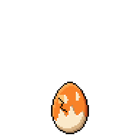 | 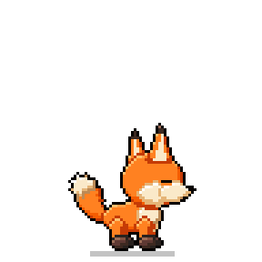 | 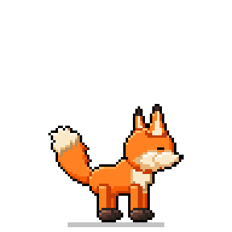 | 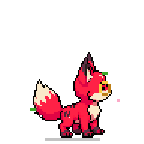 | 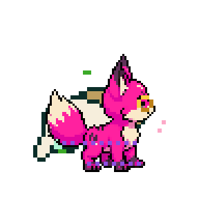 | 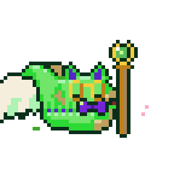 |

| 7 · Veteran | 8 · Ultimate | 9 · Mega | 10 · Legend | 11 · Mythic | 12 · Apex |
|---|---|---|---|---|---|
| 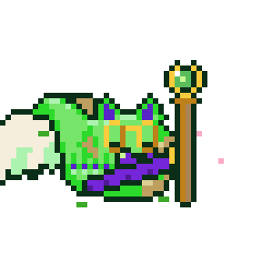 | 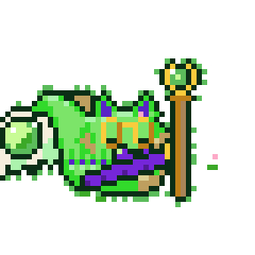 | 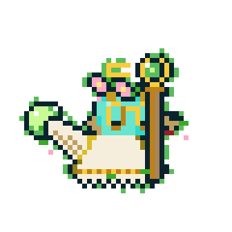 | 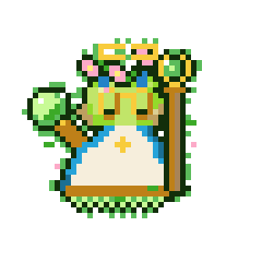 | 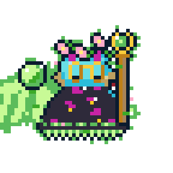 | 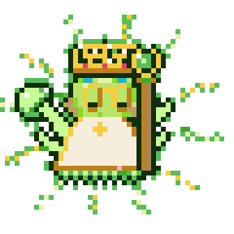 |

### Rex: a brave pup raised on games and code

Electric element, a cap and goggles, a jetpack, markings and a robot leg at Adept (a dog that flies), a two-legged hero body with a robot arm and an arm cannon at Champion, spiked armour and a robot eyepiece at Veteran, an electric orb at Ultimate. Then **Mecha** (Mega), **Kaiju** (Legend), **Dragon** (Mythic) and **Ascendant** (Apex). Fierce brows.

| 1 · Egg | 2 · Baby | 3 · Young | 4 · Rookie | 5 · Adept | 6 · Champion |
|---|---|---|---|---|---|
| 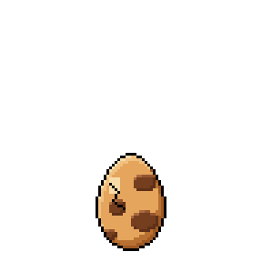 | 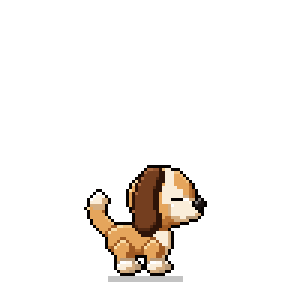 | 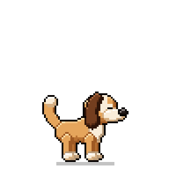 | 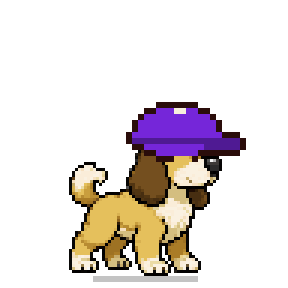 | 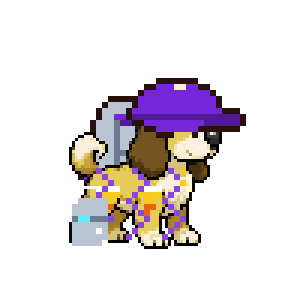 | 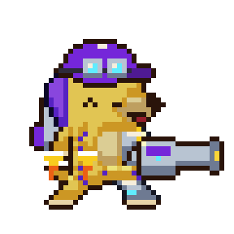 |

| 7 · Veteran | 8 · Ultimate | 9 · Mega | 10 · Legend | 11 · Mythic | 12 · Apex |
|---|---|---|---|---|---|
| 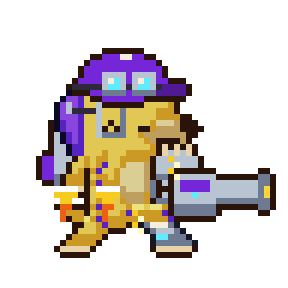 | 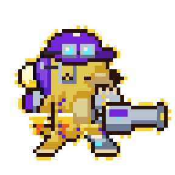 | 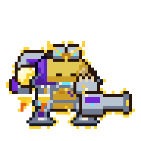 | 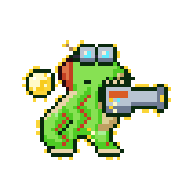 | 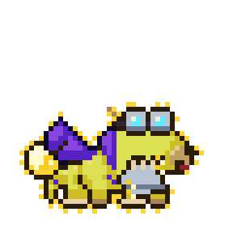 | 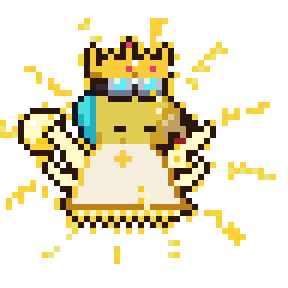 |

### Miso: a music-loving cat who watched anime and grew fierce

Headphones from music, fire from anime plus a fierce temperament, bat wings, then a serpent body; spiked armour at Veteran; an arm cannon and a fire orb at Ultimate. Then **Dragon** (Mega), **Abyss** (Legend), **Cosmic** (Mythic) and the **Orb** (Apex).

| 1 · Egg | 2 · Baby | 3 · Young | 4 · Rookie | 5 · Adept | 6 · Champion |
|---|---|---|---|---|---|
| 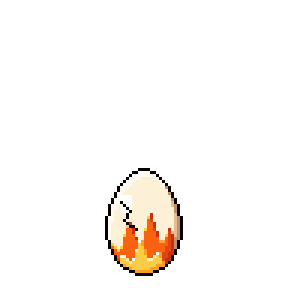 | 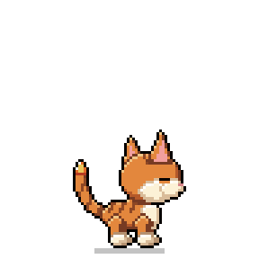 | 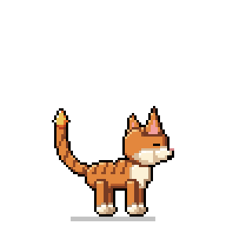 | 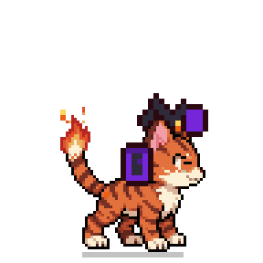 | 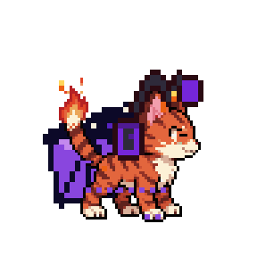 | 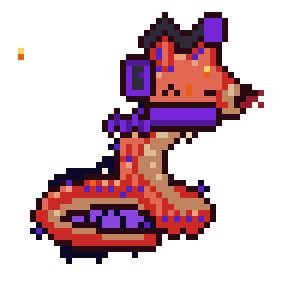 |

| 7 · Veteran | 8 · Ultimate | 9 · Mega | 10 · Legend | 11 · Mythic | 12 · Apex |
|---|---|---|---|---|---|
| 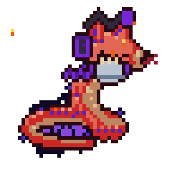 | 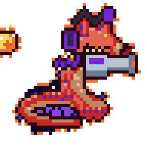 | 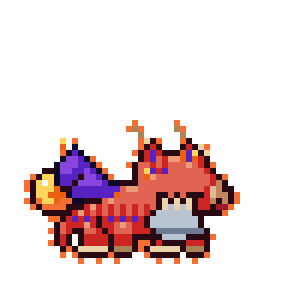 | 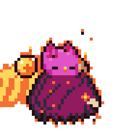 | 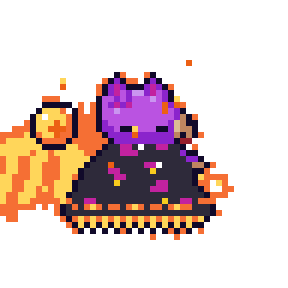 | 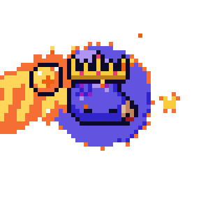 |

## How each form is chosen

All of this is decided in code (`crates/vpet-core/src/style.rs`). The same life always gives the same form, and the language model only names the form and tells its story.

| Part | Comes from |
|---|---|
| **Gear** | What it saw you do: music → headphones, coding → goggles, games → cap, videos → scarf, reading → glasses, design → beret, chat → bow tie, office → tie. If activity isn't observed, its personality: brave → bandana, curious → goggles, creative → beret or flower crown, affectionate → bow tie, competitive → cap, cautious → glasses, sociable → scarf. It keeps earlier gear; one piece per place (head, ears, eyes, neck); 1 slot at Rookie, 2 at Champion, 3 at Mega. Apex wears a crown. |
| **Element** | Its energy genes, your habits and its temperament. Watching videos brings **wind** to a gentle pet and **fire** to a fierce one; games and code bring electric; music water; reading and chat nature. |
| **Flight** (Adept+) | Coders and gamers get a **jetpack**. Otherwise independence, curiosity or wind give **wings**: bat if fierce, insect for bug-born pets, feathers otherwise; **energy wings** from Mega. |
| **Body** (Champion) | Electric + tech → **mech**. Fierce + fire or water → **serpent**. Gentle + wind, nature or water → **spirit** (floats, so it flies). Brave and not gentle → **biped**. Otherwise a little of its own randomness decides. |
| **Great forms** (Mega, Legend, Mythic, Apex) | One of fifteen at each stage, never one it has been, scored from its life: **Titan** (brave and careful), **Celestial** and **Angel** (gentle and loving), **Abyss** (fierce, independent, or neglected), **Dragon** (fierce with fire or wings), **Mecha** (code and games), **Beast King** (brave and competitive), **Spirit** and **Plant** (gentle, water and wind, or nature), **Cosmic** and **Orb** (curious, creative, reading, music), **Ancient** (careful, reading or office work), **Human** (sociable, chatting), **Kaiju** (fierce gamers), **Ascendant** (Apex only, for a well-loved pet). The grandest only come late: Cosmic and Orb from Mythic, Ascendant only at Apex. Each form brings its own colour mix. |
| **Markings** (Adept+) and **armour** (Veteran+) | Every stage shows a change: markings of its own at Adept, armour at Veteran. |
| **Robot parts** (Adept+) | A fierce or competitive pet who codes, games or carries electricity builds one per stage: a **robot leg**, then an **arm**, then an **eyepiece**. |
| **Weapon** (Champion+) | Fierce and into games or winning: an **arm cannon**. Gentle and into reading, design or new ideas: a **magic staff**. Every fierce or gentle pet has one by Ultimate. A four-legged pet's staff floats at its back. |
| **Orb** (Ultimate+) | Its element gathers into an **orb** that floats beside it. |
| **Colour** | Pulled towards the element's colour (40%, or 75% at transform stages); darker if fierce, softer if gentle. Each great form adds its own main and second colour, so the palette becomes a mix. |
| **Its own line** | A **variant** from its own seed picks its marking pattern (stripes, spots, zigzags or bands), nudges its second colour and adds a little randomness to every choice. Tested: 300 pets with random lives grew 300 different lines, every one of the fifteen forms turned up, and no stage ever looked like the one before. |
| **Temperament** | Bravery, competitiveness, independence and care mistakes (fierce) versus affection, sociality and caution (gentle), plus a small random lean from hatching. **Gender never decides it.** |
| **Always kept** | The egg animal's **face and ears** (new bodies wear its head) and the **eye colour** it hatched with. |

### Every animal on every body

Rows: its own grown body, hero (biped), robot (mech), dragon (serpent), spirit. Columns: bird, cat, dog, rabbit, grasshopper, octopus, bat, butterfly, fox.

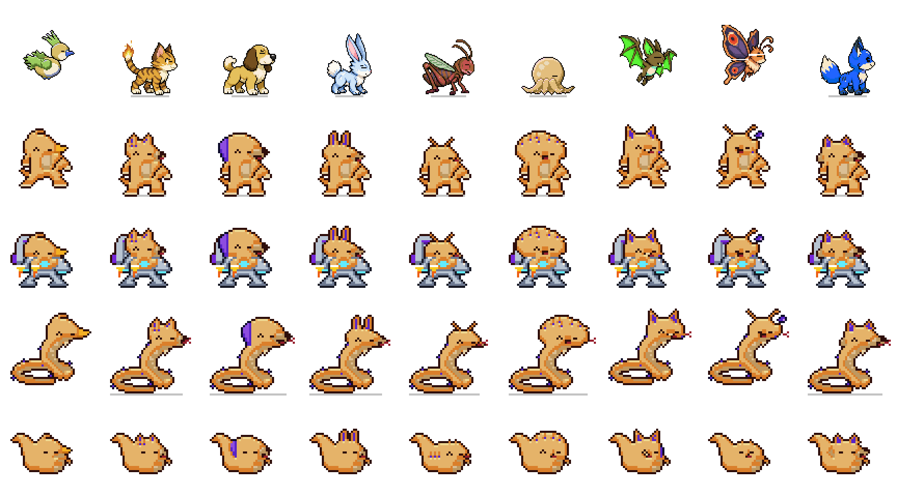

### Gear

Headphones, goggles, glasses, cap, beret, bandana, crown, flower crown, scarf, bow tie, tie.

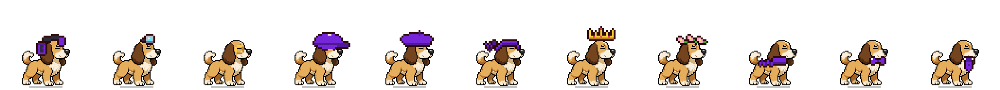

### Wings, jetpack, robot parts, weapons and orbs

Top row at rest, bottom row in action. Feather, dragon, insect and energy wings; a jetpack; a robot leg, arm and eyepiece; an arm cannon firing; a staff casting a rune circle; a water orb circling its owner. They come alive whenever the pet plays, cheers or is thrilled, and in the signature move right after it evolves.

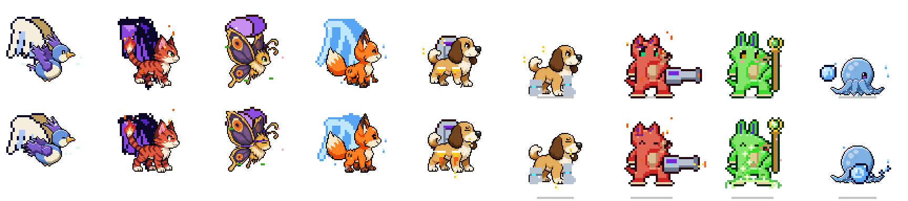

### The fifteen great forms

Titan, Celestial, Abyss, Dragon, Mecha, Beast King, Spirit, Cosmic, Ancient, Ascendant, Human, Angel, Kaiju, Plant, Orb: on a fox (top) and a pup (bottom), each in its form's colours. They wear a smaller head from the animal's Young form, so the face, ears and eye colour stay while the body takes over. Each has something live of its own: a halo, stars and a planet ring, void mist, flames, a V-fin, dragon horns, orbiting moons.

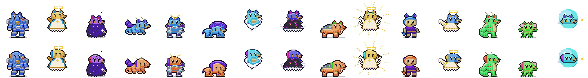

### The serpent, markings and armour

The serpent rears up in an S from its own coil. Every grown pet gets markings of its own from its seed (four patterns shown per animal), clawed paws, and armour at Veteran.

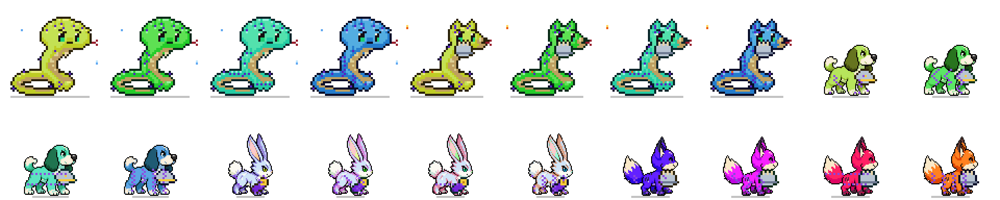

### Elements

Fire, water, wind, electric, nature.

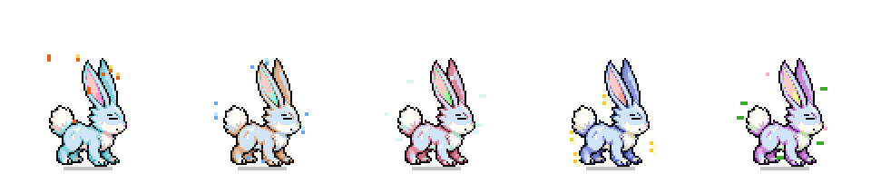

## The evolution animation

1. **Charging** (while its mind designs the new form, a few seconds to half a minute): it stays put, trembles, a white outline flickers, and motes of light rise.
2. **The transformation** (9 seconds):

| Charging | 0.4 s glow | 1.6 s old shape | 2.3 s new shape | 4.2 s faster | 5.0 s burst | 6.2 s reveal | 7.6 s signature |
|---|---|---|---|---|---|---|---|
| 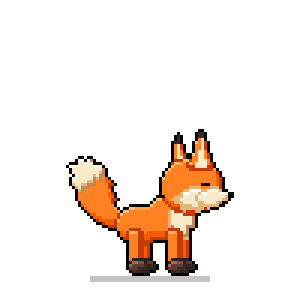 |  | 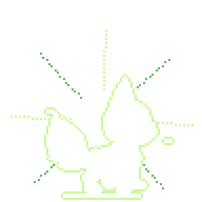 | 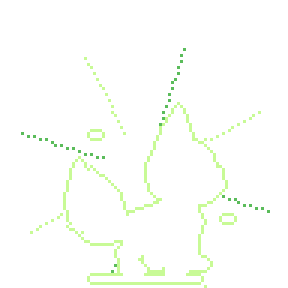 | 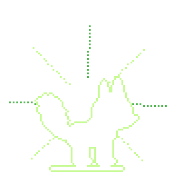 | 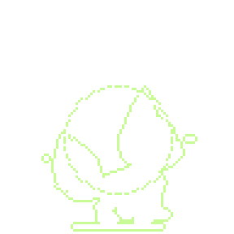 | 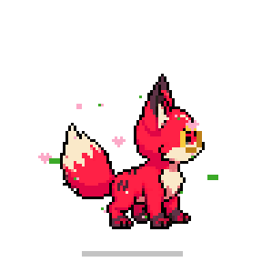 | 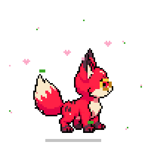 |

- **0–1 s:** the old form glows brighter.
- **1–4.8 s:** white silhouettes flash between the old and new shapes, faster and faster, with light rays turning behind.
- **4.8–5.4 s:** a burst of light, with the fanfare.
- **5.4–9 s:** the new form's **signature move**. Flyers take off and settle; its element bursts outwards; a fierce form stomps; a gentle form sends up hearts; a music lover sends up notes.

Then it tells you, in its own words at its language stage, how and why it grew: *"Look at me! I got headphones because I watched you listening to music a lot."* The Status window's **Growing up** section keeps a before-and-after card for every step.

With **reduced motion** on there is no flashing: the new form simply appears.

## Older saves

Pets from before the twelve stages keep their progress:
- *developing* → Young
- *young* → Rookie
- *mature* → Champion
- *advanced* → Ultimate

They get a gender the next time they wake up.
